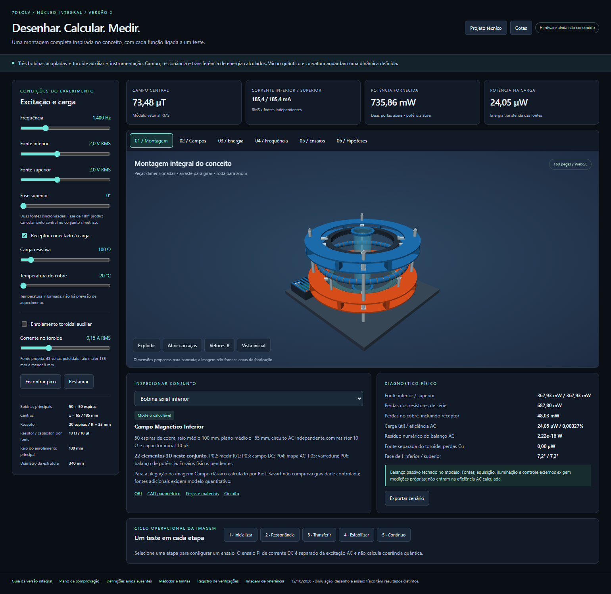

# Núcleo de Campo Toroidal Quântico — laboratório de investigação

Projeto de bancada eletromagnética com laboratório 3D offline, simulação reproduzível, peças CAD, medidas, lista de materiais e protocolo de medição. A versão integral V2 traduz os conjuntos da imagem de referência em bobinas, suportes, receptor indutivo, instrumentação proposta e controle convencional de corrente.

**Estado do projeto:** desenho e modelo clássico verificados digitalmente; protótipo físico ainda não fabricado nem medido. O nome preserva a referência artística. O código calcula eletromagnetismo clássico e não demonstra energia do vácuo, coerência quântica, propulsão sem reação, wormholes ou controle do espaço-tempo.



## Começar pelo laboratório 3D

**[Abrir o laboratório online](https://7dsol3.github.io/nucleo-campo-toroidal-quantico/)** — a página inicial reúne as simulações V2/V1, desenhos e downloads. O site é publicado pelo GitHub Pages; os cálculos continuam sendo executados no navegador.

Para desenvolver a bancada e planejar a comparação com dados reais, consulte [PROXIMOS_PASSOS.md](PROXIMOS_PASSOS.md).

```powershell
git clone https://github.com/7dsol3/nucleo-campo-toroidal-quantico.git
cd nucleo-campo-toroidal-quantico
Start-Process .\nucleo_integral_v2\index.html
```

Também é possível baixar o repositório em **Code → Download ZIP**, extrair a pasta inteira e abrir `nucleo_integral_v2/index.html` no Chrome ou Edge. Preserve os arquivos e subpastas: o HTML depende dos JavaScript, da cena CAD e dos demais arquivos locais.

O laboratório funciona offline, sem instalação de Python, servidor ou envio de dados a serviços externos. Requer navegador com WebGL. Na interface é possível:

- Girar a montagem, abrir carcaças, ver a vista explodida e selecionar conjuntos.
- Ajustar frequência, tensões, fase, carga e temperatura do modelo.
- Consultar campo vetorial, mapa de campo, resposta em frequência e balanço de potência.
- Ativar o toroide auxiliar e observar seu campo convencional, alimentado separadamente.
- Exportar o cenário e importar medições no formato de [Modelo_Medicoes.csv](nucleo_integral_v2/Modelo_Medicoes.csv).
- Consultar o ensaio separado de controle PI em corrente contínua e o estado de cada hipótese da imagem.

Leia [LEIA_PRIMEIRO.md](nucleo_integral_v2/LEIA_PRIMEIRO.md) antes de interpretar os resultados.

## Conteúdo entregue

| Conteúdo | Arquivo ou pasta |
|---|---|
| Laboratório principal V2 | [nucleo_integral_v2/index.html](nucleo_integral_v2/index.html) |
| Projeto técnico integral | [PDF](nucleo_integral_v2/Projeto_Integral.pdf), [DOCX](nucleo_integral_v2/Projeto_Integral.docx), [Markdown](nucleo_integral_v2/Projeto_Integral.md) |
| Desenhos com medidas | [Montagem dimensional](nucleo_integral_v2/cad/01_montagem_dimensional.svg), [componentes e enrolamentos](nucleo_integral_v2/cad/02_componentes_enrolamentos.svg) |
| Montagem 3D para importação | [OBJ](nucleo_integral_v2/cad/montagem_integral.obj) e [MTL](nucleo_integral_v2/cad/montagem_integral.mtl) |
| Fonte paramétrica e 14 tipos de peças STL | [cad/](nucleo_integral_v2/cad/), [fonte OpenSCAD](nucleo_integral_v2/cad/nucleo_integral.scad) |
| Fabricação, folgas e sequência de montagem | [LEIA-ME_CAD.md](nucleo_integral_v2/cad/LEIA-ME_CAD.md) |
| Lista completa de peças e instrumentos | [lista_completa_pecas.csv](nucleo_integral_v2/lista_completa_pecas.csv) |
| Circuito e fronteiras de potência | [circuito_integral.svg](nucleo_integral_v2/circuito_integral.svg) |
| Modelo Python e JavaScript | [modelo_integral.py](nucleo_integral_v2/simulacao/modelo_integral.py), [modelo_browser.js](nucleo_integral_v2/simulacao/modelo_browser.js) |
| Métodos e aproximações | [simulacao/METODOS.md](nucleo_integral_v2/simulacao/METODOS.md) |
| Parâmetros físicos do cenário inicial | [configuracao.json](nucleo_integral_v2/simulacao/configuracao.json) |
| Resultados numéricos calculados | [simulacao/outputs/](nucleo_integral_v2/simulacao/outputs/) |
| Protocolo experimental P01–P10 | [PROTOCOLO_COMPLETO.md](nucleo_integral_v2/pesquisa/PROTOCOLO_COMPLETO.md) |
| Funções do pôster ainda sem modelo executável | [INVENTARIO_LACUNAS.md](nucleo_integral_v2/pesquisa/INVENTARIO_LACUNAS.md) |
| Auditoria matemática e interpretação do conceito | [auditoria_cientifica.md](auditoria_cientifica.md) |
| Bancada inicial V1, preservada como histórico | [nucleo_toroidal/](nucleo_toroidal/), [Projeto_Tecnico.pdf](nucleo_toroidal/Projeto_Tecnico.pdf) |
| Pacotes completos | [Nucleo_Integral_V2.zip](artifacts/Nucleo_Integral_V2.zip), [Nucleo_Toroidal_Pacote.zip](artifacts/Nucleo_Toroidal_Pacote.zip) |
| Materiais fornecidos como referência | [Atlas em PDF](references/Atlas_Estruturas_Fundamentais_Adilson_Oliveira_7dsolv.pdf), [imagem do núcleo](references/Nucleo_de_Campo_Toroidal_Quantico.png) |

As versões possuem geometrias e circuitos diferentes. Use a V2 como referência para a montagem integral; não combine valores de separação, ligação ou ressonância da V1 com a V2.

## Dimensões e funcionamento do modelo V2

As cotas abaixo são escolhas propostas para uma bancada, não medidas recuperadas da escala artística de 10 m do pôster. O CAD usa milímetros e o solver usa unidades SI.

| Conjunto | Especificação inicial |
|---|---|
| Base isolante | 360 × 360 × 12 mm |
| Anéis externos | Diâmetro externo de 340 mm |
| Bobinas axiais | 50 espiras cada, raio médio de 100 mm; centros em z = 65 e 185 mm |
| Separação entre bobinas | 120 mm entre planos médios; esta V2 não é o par ideal de Helmholtz com separação igual ao raio |
| Cobre | Diâmetro nu de 1,0 mm; passo isolado nominal de 1,1 mm |
| Receptor indutivo | 20 espiras, raio médio de 35 mm, z = 125 mm, carga inicial de 100 Ω |
| Toroide auxiliar | 48 espiras poloidais; raio maior de 135 mm, raio menor do centro do fio de 8 mm |
| Coluna central | Tubo aberto ao ar, Ø54/50 × 198 mm; suporte de instrumentação |
| Portas principais | Duas fontes senoidais independentes; 10 Ω e 10 µF em série por porta |
| Cenário inicial | 2 V RMS por porta, 1.400 Hz, fase igual, 20 °C; toroide desligado |

No cenário inicial, o modelo prevê aproximadamente **185,446 mA RMS por bobina**, **73,484 µT RMS no centro**, **0,735861 W de potência total nas fontes principais** e **24,055 µW entregues à carga receptora**. São previsões de um circuito alimentado externamente, não resultados experimentais.

O solver usa fasores RMS, estimativa de autoindutância de Wheeler, indutância mútua por quadratura da integral de Neumann e campo por Biot–Savart. As 50 espiras de cada bobina principal são distribuídas nas posições do pacote. O circuito inclui a reação do receptor e verifica a conservação de potência. O campo do toroide auxiliar é integrado a partir de suas espiras poloidais.

O ensaio PI em corrente contínua é separado: capacitores contornados e receptor desconectado. Ele não representa controle CA do circuito RLC nem feedback quântico. A estimativa dimensional gravitacional documentada no solver não resolve uma métrica do espaço-tempo.

## Reproduzir os cálculos

Para executar os cálculos e os testes numéricos básicos, basta **Python 3**, sem pacotes adicionais. Os comandos abaixo partem da raiz do repositório; no Windows, `py` pode ser substituído por `python` se necessário.

```powershell
py .\nucleo_integral_v2\simulacao\modelo_integral.py --output .\nucleo_integral_v2\simulacao\outputs
py .\nucleo_integral_v2\simulacao\validar.py --output .\validacao_modelo_local.json
```

O segundo comando preserva o relatório de validação publicado e grava seu resultado local em um arquivo separado. Sem `--browser`, ele executa 38 testes numéricos; a contagem de 58 do relatório publicado inclui a paridade com o motor JavaScript.

O primeiro comando regenera os JSON/CSV e atualiza a referência numérica incorporada em `modelo_browser.js`. Antes de editar parâmetros, preserve uma cópia de `configuracao.json` e identifique a configuração usada em cada medição.

Mover os controles do navegador não altera `configuracao.json`. Alterações de raio, número de espiras ou posição exigem sincronizar a geometria no CAD e no modelo e regenerar os artefatos; essa sincronização não é automática.

### Reproduzir os testes do navegador

Os testes usam Playwright Python. O seletor de navegador aceita o caminho informado em `NUCLEO_BROWSER_PATH`, procura instalações locais de Chrome e, quando necessário, utiliza o Chromium do Playwright.

```powershell
py -m pip install playwright
py .\nucleo_integral_v2\simulacao\validar.py --browser --output .\validacao_modelo_browser_local.json
py .\nucleo_integral_v2\verificar_navegador.py
```

Se não houver um navegador compatível instalado, baixe o Chromium do Playwright com `py -m playwright install chromium`. Para escolher um executável específico no PowerShell, defina `$env:NUCLEO_BROWSER_PATH = 'C:\caminho\para\chrome.exe'` antes dos testes. Essa instalação só é necessária para automatizar testes, não para usar o HTML offline em um navegador já instalado.

`verificar_navegador.py` testa interações, renderização WebGL, importação/exportação e concordância Python/JavaScript. Também atualiza capturas de tela, o modelo vazio de medições e o cenário exportado. Execute em uma cópia de trabalho quando precisar preservar os artefatos publicados.

### Publicar e conferir o site

O workflow [pages.yml](.github/workflows/pages.yml) publica a `main` em GitHub Pages após verificar integridade, links e interação no navegador. Em pull requests, o job `navegador` de [validacao.yml](.github/workflows/validacao.yml) executa o mesmo teste HTTP. A configuração do repositório deve usar **Settings → Pages → Source: GitHub Actions**, conforme a [documentação oficial](https://docs.github.com/en/pages/getting-started-with-github-pages/configuring-a-publishing-source-for-your-github-pages-site).

Para conferir a URL publicada sem modificar os artefatos:

```powershell
py -B .\checks\verificar_site.py --url https://7dsol3.github.io/nucleo-campo-toroidal-quantico/ --output .\validacao_site_local.json
```

O comando usa Playwright e um navegador compatível, como os testes anteriores. O script `checks/preparar_pages.py --output PASTA_VAZIA` prepara uma cópia estática para testes locais; `checks/verificar_site.py --diretorio PASTA_VAZIA` serve e testa essa cópia sob o caminho do repositório. O staging não apaga pastas ocupadas nem altera os projetos de origem.

### Regenerar o CAD

Os geradores e a revisão geométrica usam somente Python padrão:

```powershell
py .\nucleo_integral_v2\cad\gerar_integral.py
py .\nucleo_integral_v2\cad\gerar_desenhos.py
py .\nucleo_integral_v2\cad\revisar_mecanica.py
```

O OBJ/STL é uma malha triangular. O SCAD é uma fonte paramétrica para OpenSCAD, cuja execução CLI ainda não foi validada nesta entrega. Não há arquivo STEP/B-rep nativo. A quantidade de 160 elementos inclui componentes repetidos e representações geométricas; os 14 STL são tipos de peças mecânicas exportados.

### Documentos e empacotamento

Ler os PDF/DOCX existentes não exige dependências Python. Para regenerar ou verificar documentos e pacote, os scripts usam os pacotes opcionais abaixo e fontes locais Arial/Consolas do Windows:

```powershell
py -m pip install reportlab python-docx pymupdf
py .\nucleo_integral_v2\preparar_entrega.py
py .\nucleo_integral_v2\verificar_entrega.py
```

O verificador da entrega depende dos relatórios de modelo, navegador e mecânica já presentes. Ele confere os artefatos, atualiza hashes e recria `Nucleo_Integral_V2.zip` na pasta acima de `nucleo_integral_v2/`. Os pacotes publicados ficam em `artifacts/`; ao atualizar a entrega, substitua ali o pacote correspondente após a validação. Os scripts `ajustar_interface.py`, `complementar_interface.py` e `corrigir_legendas.py` são auxiliares da produção original; não integram o fluxo normal de reprodução e não devem ser aplicados repetidamente.

## O que foi verificado

O [GitHub Actions](https://github.com/7dsol3/nucleo-campo-toroidal-quantico/actions) executa as verificações de cada atualização. A publicação em Pages prepara os arquivos estáticos e testa o portal e as duas simulações em navegador antes do deploy. O teste inclui navegação sob o caminho do repositório, recursos locais e interações; não é um ensaio físico.

Os relatórios incluídos registram a entrega digital de 12/10/2026:

| Evidência | Resultado registrado | Alcance |
|---|---|---|
| [Validação do modelo](nucleo_integral_v2/simulacao/outputs/validacao_modelo.json) | 58 verificações aprovadas | Casos analíticos, convergência, conservação, controle CC e paridade Python/JavaScript |
| [Validação do navegador](nucleo_integral_v2/validacao_navegador.json) | 33 verificações aprovadas | Renderização, controles, importação/exportação e layout |
| [Revisão mecânica](nucleo_integral_v2/cad/revisao_mecanica.json) | 84 interfaces aprovadas | Interfaces selecionadas e folgas geométricas |
| [Resumo da entrega](nucleo_integral_v2/validacao_entrega.json) | 160 elementos 3D e 14 STL | Integridade dos arquivos e consistência da entrega |

Essas contagens descrevem verificações digitais específicas. Não certificam fabricação, resistência mecânica, desempenho térmico, precisão absoluta do campo ou funcionamento de um protótipo físico.

## Construir e medir

A fabricação deve seguir o [projeto integral](nucleo_integral_v2/Projeto_Integral.pdf), a [lista de peças](nucleo_integral_v2/lista_completa_pecas.csv), as [instruções CAD](nucleo_integral_v2/cad/LEIA-ME_CAD.md) e o [protocolo P01–P10](nucleo_integral_v2/pesquisa/PROTOCOLO_COMPLETO.md). Fontes, amplificadores e instrumentos externos ainda precisam ser selecionados e verificados para a carga real. O pacote não contém uma PCB ou um driver de potência fabricado e validado.

Antes de energizar, confira geometria, isolamento, resistência, indutância, limites dos componentes e conexão dos instrumentos. Cada porta principal foi especificada com limite de 5 V RMS e 0,5 A RMS; isso é um requisito de projeto, não a garantia de que qualquer fonte realiza todos os pontos calculados. Alguns cenários exigem que uma fonte absorva potência da outra.

As tampas de Ø340 mm exigem equipamento com área útil compatível ou processo alternativo de fabricação. A coluna central é aberta e não foi projetada para pressão ou vácuo. Os arquivos ainda não foram fatiados, impressos nem ensaiados fisicamente.

Para comparar modelo e hardware, registre medições brutas, calibração, fase, temperatura, configuração, potência com sinal correto e incerteza. O CSV de medições está vazio. Todos os arquivos em `simulacao/outputs/`, inclusive o cenário exportado pelo navegador, contêm cálculos. Um resultado `PASS` da interface ou dos testes não é uma medição experimental.

## Limites e investigação das hipóteses

Permanecem pendentes a fabricação, os ensaios físicos, a validação térmica/estrutural, a comparação com FEM, a detecção global de colisões e a implementação da eletrônica externa. O modelo também aproxima o receptor por espiras coincidentes para certos cálculos, exclui regiões próximas aos fios e não calcula os campos dos cabos, todas as perdas CA ou as assimetrias da montagem real. Essas aproximações estão detalhadas em [METODOS.md](nucleo_integral_v2/simulacao/METODOS.md).

As alegações quânticas e gravitacionais do pôster ainda precisam de equações completas, unidades, parâmetros, mecanismo de acoplamento, condições iniciais/de contorno e observáveis mensuráveis. A matriz de lacunas preserva essas perguntas para investigação; não trata as etiquetas da ilustração como componentes físicos demonstrados.

## Referências, autoria e contribuições

A imagem de referência e o Atlas fornecidos identificam **Adilson Oliveira — 7dsolv**. Essa atribuição refere-se aos materiais de referência e não declara autoria das leis físicas convencionais utilizadas. A [auditoria científica](auditoria_cientifica.md) distingue o conteúdo editorial, os modelos conhecidos e as hipóteses ainda abertas.

Contribuições devem incluir problema, alteração, método de reprodução e evidência relevante. Consulte [CONTRIBUTING.md](CONTRIBUTING.md). Nenhuma licença de código aberto foi atribuída nesta publicação; a disponibilização dos arquivos no GitHub não constitui uma autorização geral de redistribuição ou uso dos materiais de referência.
