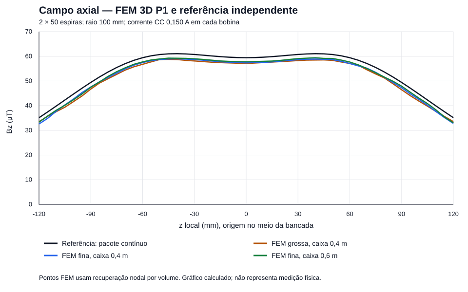
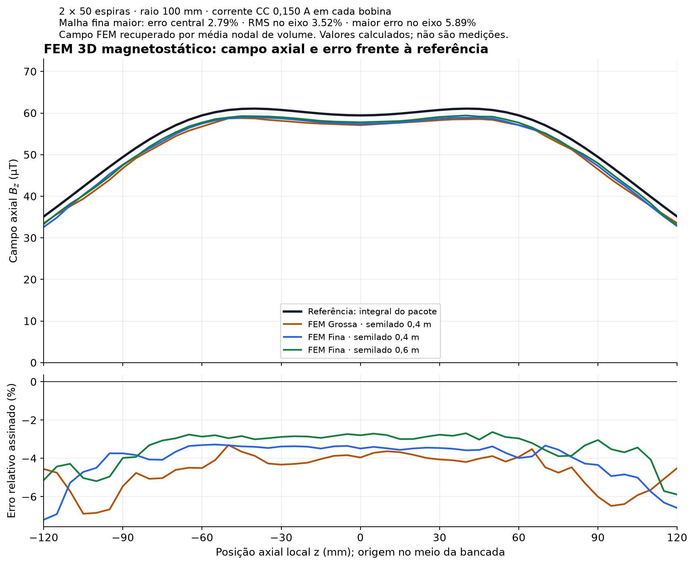

# FEM 3D executado — duas bobinas da bancada V2

Este módulo resolve um problema de elementos finitos **tridimensional**, com
tetraedros lineares P1, montagem da matriz de rigidez e solução esparsa. A
comparação com Biot–Savart é uma verificação independente: a integral não é o
solver FEM. Os arquivos publicados foram efetivamente calculados.

O resultado é uma **verificação numérica preliminar do campo magnetostático**.
Não é uma medição, uma certificação de fabricação ou demonstração de funções
quânticas do cartaz.

## Problema resolvido

| Grandeza | Valor |
|---|---:|
| Raio médio de cada bobina | 100 mm |
| Seção radial do pacote | 5,5 mm |
| Comprimento axial do pacote | 11 mm |
| Número de espiras de cada bobina | 50 |
| Corrente contínua prescrita de cada bobina | 0,150 A, mesmo sentido |
| Centros no sistema V2 | z = 65 e 185 mm |
| Centros no solver, origem no meio da bancada | z = −60 e +60 mm |
| Densidade de corrente azimutal homogeneizada | 123.966,942 A/m² |
| Permeabilidade | μ₀ = 4π × 10⁻⁷ H/m, uniforme |
| Domínio externo | cubos com semilado 0,4 m e 0,6 m |
| Condição externa | A = 0 em todas as faces do cubo |

Cada pacote é um anel de seção retangular, construído por operações de volumes
OpenCASCADE no Gmsh. A malha é conforme entre ar e enrolamento. O cobre, o
esmalte e os espaços entre os fios são substituídos por um pacote de corrente
uniforme: **os 50 fios individuais não estão resolvidos no FEM**. A integral de
referência usa o mesmo pacote; uma segunda referência usa exatamente os 5 × 10
filamentos da geometria V2.

O receptor fica aberto e sem corrente no caso CC. O toroide opcional está
desligado. Suportes e peças são considerados não magnéticos, com μ = μ₀;
condutores próximos, cabos de alimentação, materiais ferromagnéticos e correntes
parasitas não são incluídos. A propriedade real desses materiais precisa ser
confirmada antes de comparar a bancada montada com este resultado.

## Equações e discretização

Na aproximação de potencial vetorial em meio homogêneo:

\[
-\nabla^2 \mathbf A = \mu_0 \mathbf J,\qquad
\mathbf B=\nabla\times\mathbf A.
\]

Para cada componente cartesiana e função de teste P1 nula no contorno externo:

\[
\int_\Omega \nabla A_k\cdot\nabla v\,dV
=\mu_0\int_{\Omega_{bobinas}}J_k v\,dV.
\]

O solver calcula as gradientes constantes de cada tetraedro e monta
`K_ij = Σ_e V_e ∇N_i·∇N_j`. O carregamento usa quadratura tetraédrica de quatro
pontos. A solução usa gradientes conjugados com pré-condicionador diagonal,
`rtol=1e-10`. A matriz é simétrica e positiva definida após eliminar os graus de
liberdade de Dirichlet: a energia gradiente só se anula para uma função constante,
e o contorno homogêneo elimina essa constante.

**Limitação de calibre e contorno:** a redução de Maxwell ao Laplaciano vetorial
pressupõe calibre de Coulomb e domínio livre apropriado. Aqui é usada a forma
regularizada `∫∇A:∇v`, com contorno truncado A = 0. Não há multiplicador de
Lagrange impondo `div A = 0` exatamente. O diagnóstico publicado
`||div A||L2 / ||curl A||L2` é aproximadamente **11,07%** na malha fina de caixa
maior, com parcela de calibre da energia de aproximadamente **1,23% da energia
magnética**. Isso exige cautela perto dos enrolamentos e impede declarar que
todo o campo 3D foi validado com erro de 2,79%. Uma formulação H(curl) com calibre
controlado, elementos de ordem superior e estudo adicional de refinamento é
apropriada para certificação posterior. A comparação independente abaixo delimita
os pontos e a precisão efetivamente verificados.

`B_raw_T` é o rotacional constante por tetraedro. `B_recovered_T` é a média nodal
ponderada pelo volume dos tetraedros incidentes, interpolada para os gráficos e
amostras. Esse pós-processamento suaviza o campo e não transforma P1 em P2.

## Resultados da execução publicada

| Caso | Nós | Tetraedros | Bz central FEM | Erro central frente ao pacote | Erro relativo RMS no eixo |
|---|---:|---:|---:|---:|---:|
| Malha grossa, semilado 0,4 m | 10.494 | 60.393 | 57,0873 μT | 3,96% | 4,72% |
| Malha fina, semilado 0,4 m | 33.336 | 200.346 | 57,3658 μT | 3,49% | 4,17% |
| Malha fina, semilado 0,6 m | 33.000 | 196.661 | 57,7779 μT | 2,79% | 3,52% |

Referência central do pacote: **59,438566 μT**. Referência central dos 100
filamentos V2: **59,438628 μT**. Esta corrente CC difere do cenário AC de
2 V RMS e 1.400 Hz da V2; não comparar esses dois campos sem igualar as correntes.

A amostragem contém 49 pontos de eixo, de −120 a +120 mm locais. O maior erro
nesses pontos da caixa fina maior é **5,89%**. Há também 15 pontos fora do eixo,
com x = 25, 50 ou 75 mm; y = 20 mm; z = −90, −30, 0, +30 ou +90 mm. A referência
fora do eixo é uma integral volumétrica independente de Biot–Savart, com Gauss
10 × 10 na seção e 256 amostras angulares. O erro vetorial RMS nesses pontos é
**3,13%**; o maior erro vetorial é **5,65%**.

O centro muda **0,49%** ao refinar a malha da caixa de 0,4 m e **0,72%** ao aumentar
o domínio. A segunda mudança inclui a alteração da malha externa de 80 para
100 mm e a remalhagem do domínio: não isola perfeitamente o erro de truncamento.
Duas malhas não estabelecem ordem assintótica nem um limite certificado de erro.
O erro máximo no eixo não cai monotonicamente em todos os casos. O relatório
mostra essas métricas, sem ocultar a variação.

Foram aprovadas **23 verificações numéricas**, incluindo:

- caso manufaturado `A=(∏sin(π(x_i+0,5)),0,0)` no cubo unitário, com erro L2
  relativo reduzido de 14,79% para 4,18% ao refinar;
- resíduos dos graus de liberdade livres menores que 10⁻¹⁰;
- simetria da matriz e diagonais positivas;
- consistência da energia variacional `½ AᵀKA = ½ Aᵀf`;
- volume discretizado do enrolamento dentro de 1% do volume analítico;
- comparações de campo central, eixo e pontos fora do eixo;
- diferenças declaradas entre malhas e domínios.

O balanço variacional é um teste do sistema discreto, **não um balanço elétrico
de potência**. `magnetic_energy_J` usa `∫B²/(2μ₀)`; a energia variacional contém
também o termo de calibre. Os dois valores estão separados no JSON.





[Gráfico vetorial SVG com painel de erros](outputs/campo_eixo_comparacao.svg).

## Reproduzir

Python 3.12 foi usado na execução. Instale as dependências em ambiente isolado.
Não é necessário OpenSCAD para este módulo.

```powershell
py -3.12 -m venv .venv-fem
.\.venv-fem\Scripts\python.exe -m pip install -r bancada_v3/fem/requirements.txt
.\.venv-fem\Scripts\python.exe -B bancada_v3/fem/solver.py
.\.venv-fem\Scripts\python.exe -B bancada_v3/fem/render_results.py
.\.venv-fem\Scripts\python.exe -B bancada_v3/fem/plot_results.py
.\.venv-fem\Scripts\python.exe -B bancada_v3/fem/validate_artifacts.py --mesh
.\.venv-fem\Scripts\python.exe -B bancada_v3/fem/build_package.py
```

Linux/macOS: `python3 -m venv .venv-fem`; use `.venv-fem/bin/python` nos comandos
seguintes. O wheel Gmsh pode exigir a biblioteca de sistema `libGLU.so.1` em
Linux (por exemplo, pacote `libglu1-mesa` em Ubuntu). O conjunto publicado foi
executado em Windows; não há alegação de execução em outras plataformas.

`solver.py --output caminho` muda a pasta de resultados. A execução completa
gera três casos magnetostáticos e dois casos manufaturados. O processo retorna
código diferente de zero se alguma das 23 verificações falhar. Os valores de
tolerância estão no código, juntamente com os valores observados.

`validate_artifacts.py` verifica os artefatos salvos usando apenas a biblioteca
padrão; `--mesh` também lê todos os vetores/conectividade via meshio/NumPy,
confere que VTU e NPZ contêm a mesma malha e recalcula `curl A` para verificar o
campo bruto exportado. Essa leitura completa também foi executada.

## Abrir a malha e os campos

[Baixar pacote completo FEM com malha, campos, scripts e resultados](FEM_3D_Resultados.zip).

- [VTU completo da malha fina maior](outputs/fine_box060.vtu): abrir no ParaView;
  `Slice` revela os enrolamentos; selecionar `B_raw_T` em dados das células ou
  `B_recovered_T` em dados dos pontos; usar `Glyph` para vetores e `Stream Tracer`
  apenas como visualização interpolada.
- [Malha NPZ](outputs/fine_box060_mesh.npz): `points_m`, `tetrahedra` e
  `winding_region`; leitura com NumPy, conectividade de base zero.
- [Relatório JSON](outputs/resultados.json): configuração, versões, diagnósticos,
  resultados e verificações.
- [CSV no eixo](outputs/fine_box060_eixo.csv) e
  [CSV fora do eixo](outputs/fine_box060_fora_eixo.csv): valores SI e erros.

O gráfico SVG é gerado dos CSV. Não é uma ilustração sintética de um reator.

## Alcance físico

O cálculo prevê campo para **correntes impostas**, em geometria e materiais
idealizados. Não dimensiona drivers, não simula a fonte, não calcula ressonância,
perdas AC, aquecimento, esforços, vácuo, efeitos quânticos ou curvatura do
espaço-tempo. Para confronto experimental: medir a corrente CC real de cada
bobina e posição/orientação do sensor, subtrair o campo de fundo e registrar
incertezas. Divergências desse modelo devem primeiro ser confrontadas com
geometria, materiais, fontes, sensores e erros numéricos.

## Referências primárias

- [Gmsh — manual e API](https://gmsh.info/doc/texinfo/gmsh.html): volumes
  OpenCASCADE, fragmentação conforme, campos de tamanho e malhas tetraédricas.
- [FEniCS Tutorial, Volume I](https://pub.fenicsproject.org/tutorial/pdf/fenics-tutorial-vol1.pdf):
  forma fraca de Poisson e exemplo de potencial magnético; o código presente é
  uma implementação própria P1 em 3D e **não usa o solver FEniCS**.
- [SciPy — `scipy.sparse.linalg.cg`](https://docs.scipy.org/doc/scipy/reference/generated/scipy.sparse.linalg.cg.html):
  requisito de matriz positiva definida, critérios de parada e pré-condicionamento.
- [meshio — projeto e formatos](https://github.com/nschloe/meshio): exportação VTU
  com campos nodais e campos das células.
